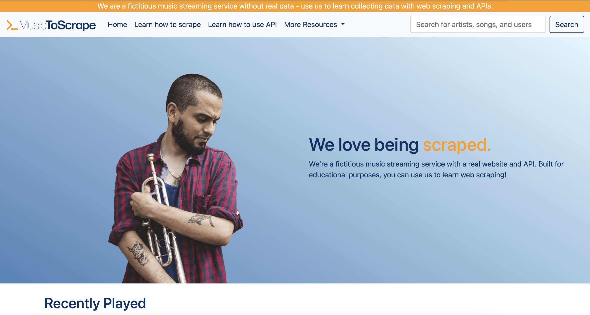
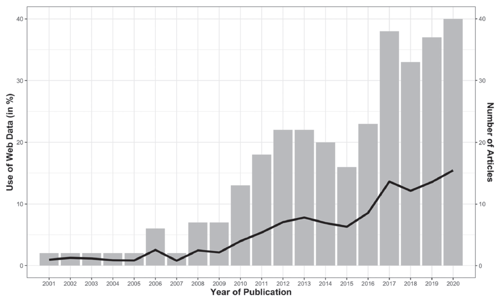
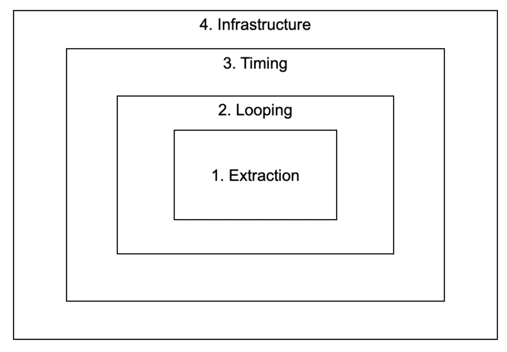
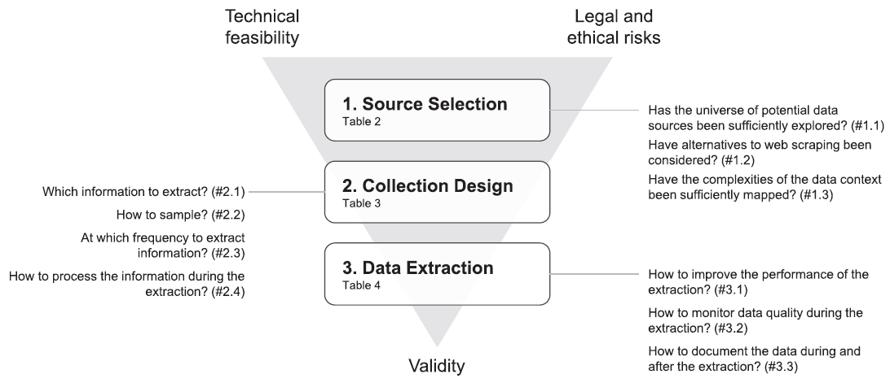
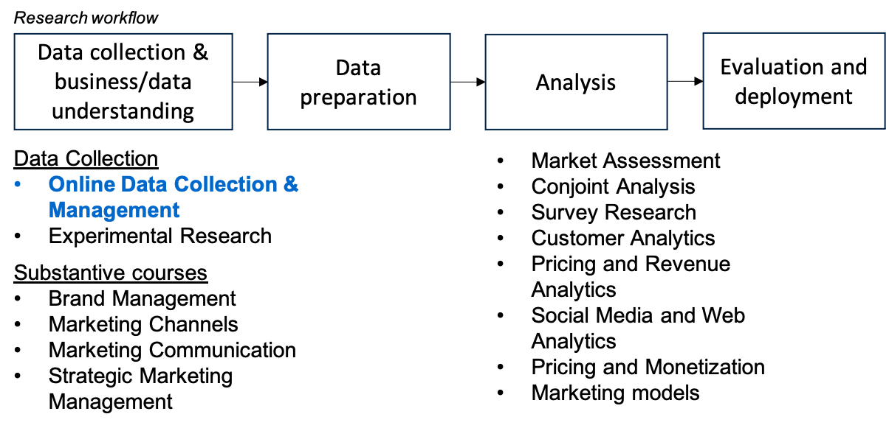

## Welcome to oDCM!

We're about to start with the first lecture of this class.

If you haven't done so, please check out the **Canvas page** for this course:

- explore the *course syllabus* 
- complete the *software preparation* (see "Preparation before the course starts")
- check out today's slides on the *modules* page on Canvas

<!--
- drafted this course for a very long time
- finally got the chance to teaching it now
- what is it about: radical change in the way to work on data-intensive projects
- anything you've learnt so far is about stats, or substantive areas, not about HOW to work on projects
- happy to share that vision, and share practical tips
-->


## Agenda

- Part 1 (10.45 to about 11.45)
  - Getting to know each other  
  - Motivation for the course  
  - Course framework and learning goals  
  - Agenda and practical arrangements  
- Break  
- Part 2: Python Bootcamp on your laptops (about 12.00 – 13.45/14.00)

---

## This course in a nutshell

- You will learn how to **write code that automatically downloads and structures information from the internet for the purpose of (scientific) analysis**.
- We call these programs “web scrapers” (for any internet pages) and “APIs” (for official data access)
- Web scraping are the foundation of Google Search (“web spiders”) and ChatGPT (e.g., for training); APIs are at the core of many business models (e.g., Twitter API – back in the days; OpenAI API)
- I also almost got sued doing scraping (more about it later...)

---

## Disclaimer

::: incremental
- Mix of lectures, teamwork and self-study — all are necessary
  - I do the tutorials, lectures and course coordination
  - Jeroen Swolfs will coach you on the team projects
- This is predominantly about web scraping and APIs — while I teach a bit of Python, becoming an expert requires years of practice  
- About me
  - I record my lectures and post them on Canvas (remind me if I miss to post one--or forget to start the recording)
  - Consider me your coach
  - Slow me down when needed
- You will have to invest a lot of time and energy (but the rewards are high!)

:::

## About myself {.incremental}

- scraping nerd — learned it in 2008 using Visual Basic in Excel  
- started doing my own research with scraped and API-extracted data in 2012 (so, 10+ years experience)  
- left Germany around your age, now 18+ years in the Netherlands
- Full Professor of Digital Marketing and Artificial Intelligence at Tilburg University

---

## Key areas of expertise

**Substantive interests**

- digital media consumption (e.g., streaming services, digital TV, and short-video platforms)
- digital platforms and artificial intelligence
- retailing and open science

**Methodological interests**

- online data collection via APIs and web scraping
- causal effects with observational data
- econometric models for managerial decision-making and public policy

---
<!--
## Teaching activities

- MSc Marketing Analytics  
  - Data preparation and programming skills
  - Online data collection and management
  - MSc Thesis supervision 
- Other initiatives  
  - tilburg.ai <https://tilburg.ai>  
  - Tilburg Science Hub <https://tilburgsciencehub.com>  
  - **Music-to-scrape.org <https://music-to-scrape.org>  **
  - YouTube <https://youtube.com/c/hannesdatta>  
  - GitHub <https://github.com/hannesdatta>  
  - Personal site <https://hannesdatta.com>  

---
--> 

## Getting to know you {.incremental}

<!--- What’s your background / previous education?  -->
- How did dPrep go for you (e.g., programming)?
- Any experience in Python already?
- What are your passions & talents? (+ why I am asking you this...)  

---

## Motivation for the course

- started out as a PhD student without data  
- was interested in music, and found website with data (<https://last.fm>)  
- no best practices in scraping; learnt all by myself and made many mistakes  
- scraping was undervalued in academic job market — **but** — key role in shaping relevance and rigor of your work  
- now scraping and APIs are a large part of what defines my research  

---

## Selection of scraping projects {.incremental}

- [scraped reviews at Amazon.com](https://journals.sagepub.com/doi/abs/10.1509/jm.11.0560)  
- [how music consumption changed with Spotify](https://tiu.nu/spotify)  
- [Spotify new releases monitor](https://github.com/hannesdatta/data-spotify-promotions-releases)  
- [power imbalances in the music industry](https://papers.ssrn.com/sol3/papers.cfm?abstract_id=4079693)  
- [playlist ecosystem data](https://github.com/hannesdatta/data-spotify-playlist-ecosystem)  
- 100k+ images from Amazon, Google Vision/NLP API  
- video streaming wars (Netflix vs Disney+)
- [methodological framework on scraping/APIs](https://doi.org/10.1177%2F00222429221100750)  
- faced legal battles…  

---

## What is scraping, and what are APIs?

**Web scraping:** anything you can view in a web browser  

- pricing data at [bol.com](https://bol.com)  
- reviews at [Amazon.com](https://amazon.com)  
- movie data at [imdb.com](https://imdb.com)  

**APIs:** official interfaces by firms for programmatic data access  

- e.g., Instagram, Twitter/X, ChatGPT, AWS  
- researchers use them to construct datasets from analytics firms  

---

## Introducing music-to-scrape.org

- Mock-up streaming service  
- Developed and released as part of Guyt et al. (2024)  
- “Safe” and controlled environment to learn scraping and APIs  



---

## Quick web scraper in Python (I)

```{python}
#| echo: true
import requests
url = 'https://music-to-scrape.org/'
webrequest = requests.get(url)
```

---

## Quick web scraper in Python (II)

```{python}
#| echo: true
from bs4 import BeautifulSoup
soup = BeautifulSoup(webrequest.text)
weekly15 = soup.find('section', {'name':'weekly_15'})
for song in weekly15.find_all('h5'):
  print(song.text)

```

---

## Quick APIs in Python

```{python}
#| echo: true
import requests
api_request = requests.get('https://api.music-to-scrape.org/charts/top-tracks')
api_request_json = api_request.json()
for song in api_request_json.get('chart'):
    print(song.get('name'))
```

---

## Opportunities with web data {.incremental}

**For businesses**

* connect to (AI) services (e.g., use ChatGPT in your own products)
* market research (e.g., retrieve pricing data regularly)
* build recommendation systems or search (e.g., for a web shop)

**For research**

* document novel phenomena without formal data access
* improve methods (text, image, video data, ...)
* achieve more accurate inferences by getting better control variables
* collect real-world metrics managers care about

---

## Getting inspired {.incremental}

* What’s the last app/website that made you say “wow”?
* Which three apps/websites would you definitely remove in the next month?
* Which three apps/websites would you definitely keep for the next year?
* What’s a niche online community you’re part of?
* What’s the last thing you saw on TikTok that made you stop scrolling?
* Imagine an AI tool that makes you famous overnight — what would it do?

---

## Why care (as a marketing researcher…)



---

## Web data versus other marketing data (I)

**Yes, but collecting *web data* is different!**

* Finding the right data source (many exist)
* Different formats (website vs API vs CSV)
* Access to data that’s not publicly available

---

## Web data versus other marketing data (II)

* Extraction design:

  * Which info to select
  * What variables exist
  * Legal and ethical considerations

---

## Web data versus other marketing data (III)

* Collecting at scale

  * Fully automatic but error-prone
  * Monitoring required
  * Poor documentation, unclear generalizability

---

## Structured approach to data collections



---

## Detailed guidance (Boegershausen et al. 2022)



---

## Learning goals {.incremental}

* Explain how to use and enrich (web) data for creating marketing insight
* Select and evaluate data sources for specific research or business needs
* Design data collection workflows, balancing validity, technical feasibility, and legal/ethical risks
* Collect data via web scraping and APIs in Python, with and without LLM assistance
* Document and archive collected data and make it available for public (re)use

---

## Positioning in the study program



---

## Course structure I: Overview

- Weeks 1-3: Tutorials (Hannes)
- Weeks 4-7: Team Project (coach Jeroen) + two lectures (Hannes, weeks 4-5)


---

## Course structure II: Tutorials

- Five tutorials:
  - __This week:__ Python Bootcamp
  - Week 2: Web scraping 101 (static) + Web scraping advanced (dynamic)
   - Week 3: API 101 (data extraction) + API Advanced (AI APIs, including OpenAI and other models)
- Structure of each tutorial
   - interactive walk-through ("semi-lecture") with a Jupyter Notebook posted on Canvas (no slides)
  - discussion how to solve and accompanying you to learn coding to solve questions
  - solutions available
  
<br> 
Key responsibility: __Hannes Datta__

---

## Course structure III: Lectures

- provide __theory and context__...
- in the form of 
  - lectures, and
  - recorded webclips 
  
<br>
key responsibility: __Hannes Datta__

---

## Course structure IV: Team project


* Collect data (scraping/APIs)
  * Apply frameworks (Boegershausen et al. 2022, Guyt et al. 2024)
  * Collect data for a research project
   * On-campus coaching sessions (10-15 minutes per team)
   * 4 group members (3 = exception)

<br>
Key responsibility: __Jeroen Swolfs__

---

## Course structure V: Team project (AI use)

__AI use:__ [Level 3](https://www.tilburguniversity.edu/sites/default/files/download/AI%20Index%20-%20TSHD%20-%202026.pdf) by default; Level 4 for specified tasks.

- Level 3: use AI for initial ideas, structures, outlines, and code.
- Level 4: for specified tasks, AI may complete parts of the work; critically evaluate its output.
- Set up [ScrAPI on Tilly](https://chatbot.tilburg.ai/private/invite?token=324c6713-ff69-4cbb-b488-d64cba996c20), the [Tilburg.ai VS Code extension](https://marketplace.visualstudio.com/items?itemName=Tilburgaichat.tilburg-ai), and an API key from [Tilburg University's API Platform](https://api-portal.tilburg.ai/start).
- Never enter private or confidential information into AI tools.

<br>

__We will share several course-specific chatbots with you on Tilburg University's chatbot platform Tilly.__

## Assessment (6 ECTS version!)

- __Computer exam__ (60%, 120 minutes) → on campus, with internet  
   - Mix of open + closed questions
   - AI use is partly permitted: some parts are Level 1 (no AI), while permitted AI use will be considered in grading (both the process and the final output)
   - Example questions will be shared on Canvas; exam Q&A in week 6 + during the final lecture in week 7
- __Team project (40%)__ → submission on Canvas + self- and peer-assessment

## Tips & tricks

- Familiarize yourself with this course (e.g., syllabus) on Canvas
- Early weeks are toughest, but skills build quickly
- Collaborate and help each other
- Recall that coding can be frustrating & tiring + you're learning a new language (Python) &rarr; take breaks, get our support

&rarr; __Quick support?__ Use the [course chatbot on Tilly](https://chatbot.tilburg.ai).

---

## Questions and support

- For project questions, contact **Jeroen Swolfs**.
- For course questions, contact **Hannes Datta** by [email](mailto:h.datta@tilburguniversity.edu) or WhatsApp.

+31 13 466 8938

---

## What’s in for you?

* Research skills (relevant & rigorous work)
* Entrepreneurial skills (data-based business)
* Coding showcase

---

## Any questions so far?

---

## Next steps


- Find a group and register by week 2 (4 students; 3 is an exception; mix skills!)
- Complete the software preparation and confirm access to JupyterLab
- Most up-to-date info: Canvas &rarr; (weekly) modules

<br>

After a well-deserved break → **Python bootcamp**.
